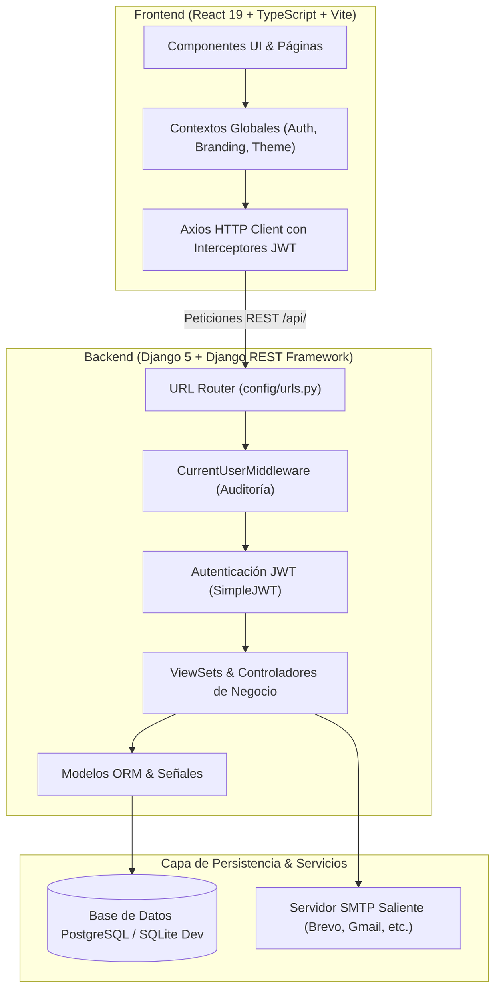
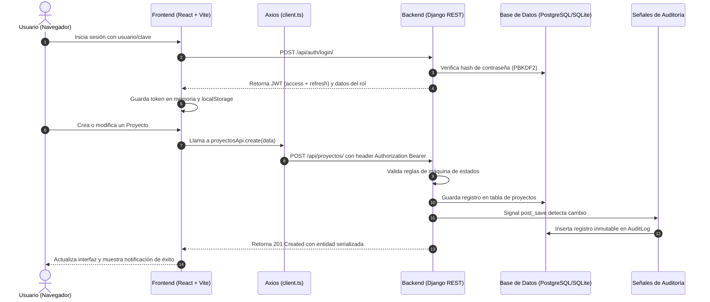

# Documentación Técnica e Integral del Sistema: Gestor de Proyectos

Bienvenido a la documentación técnica y funcional completa del **Gestor de Proyectos**. Este documento detalla la arquitectura, el modelo de negocio, el flujo de datos y la responsabilidad exacta de cada archivo que compone tanto el Backend (Django) como el Frontend (React + TypeScript).

---

## 1. Visión General del Sistema y Propósito de Negocio

El **Gestor de Proyectos** es una plataforma empresarial integral desarrollada para gestionar el ciclo de vida completo de proyectos tecnológicos, consultoría e implementación de software.

### Objetivos Clave de la Plataforma:
1. **Gestión de Clientes y Empresas**: Registro de clientes corporativos con contactos múltiples, historial comercial y soporte para papelera de reciclaje (eliminación lógica).
2. **Ciclo de Vida de Proyectos**: Motor de transiciones de estados determinista y validado (*Oportunidad*, *Trabajando*, *Pausado*, *Concretado*, *Caído*). Incluye vistas Kanban, asignación de líderes y miembros del equipo.
3. **Distribución y Seguimiento de Tareas**: Flujo operativo de tareas con prioridades, fechas límite y un mecanismo de confirmación pública mediante enlaces con tokens de un solo uso para desarrolladores/empleados (sin requerir login previo).
4. **Acuerdos Financieros y Facturación**: Control de planes de financiación, cobro por cuotas o entregables, seguimiento de estados de pago y soporte para cotización dual en moneda local (ARS) y Dólares (USD).
5. **Reuniones y Actas de Minutas**: Planificación de encuentros presenciales, virtuales o telefónicos, registro de asistencia interna y externa, exportación a formato iCalendar (.ics) y visualización en calendario interactivo.
6. **Seguridad y Control de Acceso por Roles (RBAC)**: Distinción clara entre **Recursos Humanos (RRHH)**, **Gerencia (GERENTE)** y **Empleados (EMPLEADO)**, con autenticación JWT, tokens HttpOnly y protección contra ataques CSRF y XSS.
7. **Auditoría Automática**: Registro histórico e inmutable de cada operación de creación, modificación o eliminación en tablas críticas.
8. **Infraestructura de Notificaciones**: Servidor SMTP con cifrado simétrico AES-Fernet para claves de correo y plantillas HTML enriquecidas.
9. **Personalización Institucional (Branding & Temas)**: Personalización en caliente del nombre de la plataforma y logotipo corporativo, además de modos visuales Claro, Oscuro y Lectura (Sepia).

---

## 2. Arquitectura Tecnológica y Stack Completo

### Tecnologías Empleadas:
* **Backend**:
  * **Python 3.12** y **Django 5.0+**
  * **Django REST Framework (DRF)** para la exposición de endpoints RESTful.
  * **django-rest-framework-simplejwt**: Emisión y refresco de tokens JSON Web Token (JWT).
  * **Cryptography (Fernet AES-128)**: Cifrado simétrico de credenciales SMTP en base de datos.
  * **django-filter** y **django-cors-headers**: Filtrado dinámico por parámetros de consulta y control de acceso cruzado.
  * **icalendar**: Generación dinámica de eventos de calendario estándar `.ics`.
* **Frontend**:
  * **React 19** con tipado estricto en **TypeScript**.
  * **Vite 8**: Servidor de desarrollo ultrarrápido y empaquetador optimizado.
  * **Tailwind CSS**: Diseño moderno, responsivo y utilitario con temas visuales.
  * **React Router DOM 7**: Enrutamiento declarativo del lado del cliente con guardias de ruta (`ProtectedRoute`).
  * **@tanstack/react-query**: Caché, invalidación y sincronización asíncrona de datos del servidor.
  * **Lucide React**: Set unificado de iconografía vectorial.
  * **Recharts**: Renderizado de gráficos interactivos para el Tablero Directivo.

---

## 3. Matriz de Roles y Reglas de Negocio

El sistema implementa tres roles claramente delimitados:

| Módulo / Funcionalidad | Recursos Humanos (RRHH) | Gerente (GERENTE) | Empleado / Programador |
| :--- | :---: | :---: | :---: |
| **Tablero de Métricas (Dashboard)** | Acceso a métricas globales | Acceso completo con gráficos ejecutivos | Sin acceso (redirigido a Proyectos) |
| **Empresas y Clientes** | Crear, Editar, Enviar a Papelera, Restaurar | Lectura de empresas y contactos | Sin acceso |
| **Proyectos** | Gestión total (Crear, Editar, Asignar) | Lectura, Cambio de Estado y Tablero Kanban | Lectura de proyectos asignados y Kanban |
| **Tareas Asignadas** | Crear, Editar, Asignar y Reordenar | Visualización y seguimiento de avance | Ver tareas propias y cambiar estado |
| **Confirmación de Tareas por Token** | Acceso público | Acceso público | Confirmar lectura/inicio/fin sin login |
| **Financiación y Cobros** | Crear acuerdos, cuotas y registrar pagos | Consulta y análisis de ingresos en USD/ARS | Sin acceso |
| **Reuniones y Minutas** | Planificar, redactar minutas y completar | Planificar y consultar actas | Ver reuniones donde es participante |
| **Calendario de Eventos** | Acceso completo (Reuniones, Cuotas, Tareas) | Acceso completo | Acceso a sus asignaciones |
| **Gestión de Personal & Invitaciones** | Crear invitaciones, aprobar altas, nómina | Solo lectura de personal activo | Sin acceso |
| **Auditoría del Sistema** | Acceso a logs de trazabilidad | Acceso a logs de trazabilidad | Sin acceso |
| **Configuración de Correo (SMTP)** | Configurar y probar servidor saliente | Configurar y probar servidor saliente | Sin acceso |
| **Configuración Personal & Contraseña** | Acceso completo | Acceso completo | Acceso completo |
| **Identidad Visual & Logo** | Modificar nombre y logotipo | Modificar nombre y logotipo | Modificar nombre y logotipo |

---

## 4. Desglose Exhaustivo de Archivos del Backend (`backend/`)

### 4.1. Raíz del Backend
* [`manage.py`](file:///C:/Users/usuario/.gemini/antigravity/scratch/gestor-proyectos/backend/manage.py): Script de entrada estándar de Django para ejecutar comandos de consola (migraciones, servidor de desarrollo, pruebas, creación de superusuarios).
* [`requirements.txt`](file:///C:/Users/usuario/.gemini/antigravity/scratch/gestor-proyectos/backend/requirements.txt): Declaración estricta de dependencias Python del backend (Django, DRF, SimpleJWT, psycopg2, cryptography, etc.).
* [`.env.example`](file:///C:/Users/usuario/.gemini/antigravity/scratch/gestor-proyectos/backend/.env.example): Plantilla de variables de entorno recomendadas (credenciales de BD, SECRET_KEY, modo DEBUG, CORS).
* [`Dockerfile`](file:///C:/Users/usuario/.gemini/antigravity/scratch/gestor-proyectos/backend/Dockerfile): Archivo para compilar y empaquetar el backend en una imagen Docker autónoma basada en Python Alpine o Slim.

### 4.2. Configuración Central (`backend/config/`)
* [`config/settings.py`](file:///C:/Users/usuario/.gemini/antigravity/scratch/gestor-proyectos/backend/config/settings.py): Núcleo de configuración de Django:
  * Registro de aplicaciones internas (`apps.core`, `apps.empresas`, etc.) y de terceros (`rest_framework`, `corsheaders`).
  * Conexión a base de datos (PostgreSQL como opción primaria, SQLite como fallback transparente para desarrollo rápido).
  * Políticas de seguridad HTTP, cookies HttpOnly, configuración de SimpleJWT con expiración de 1 día para access token.
  * Parámetros de subida de archivos (límite de 5 MB, tipos permitidos) y directorio MEDIA.
* [`config/urls.py`](file:///C:/Users/usuario/.gemini/antigravity/scratch/gestor-proyectos/backend/config/urls.py): Enrutador maestro del backend. Prefija todas las APIs bajo el namespace `/api/` y mapea los endpoints de login, logout, refresh de token, administración Django y rutas de cada app.
* [`config/wsgi.py`](file:///C:/Users/usuario/.gemini/antigravity/scratch/gestor-proyectos/backend/config/wsgi.py): Punto de entrada para servidores WSGI tradicionales de producción como Gunicorn o Waitress.
* [`config/asgi.py`](file:///C:/Users/usuario/.gemini/antigravity/scratch/gestor-proyectos/backend/config/asgi.py): Punto de entrada asíncrono para servidores ASGI como Uvicorn.

---

### 4.3. Módulo Núcleo y Servicios (`backend/apps/core/`)
Este módulo concentra la infraestructura transversal a toda la plataforma: trazabilidad, archivos adjuntos, recordatorios, seguridad y correo.

* [`apps/core/models.py`](file:///C:/Users/usuario/.gemini/antigravity/scratch/gestor-proyectos/backend/apps/core/models.py):
  * `AuditLog`: Almacena la tabla afectada, ID de registro, acción (`CREAR`, `MODIFICAR`, `ELIMINAR`), campos modificados con valor anterior/nuevo, usuario autor y dirección IP.
  * `Adjunto`: Modelo polimórfico mediante `GenericForeignKey` que permite asociar archivos físicos o enlaces de Google Drive/OneDrive a cualquier entidad (empresas, proyectos, reuniones, tareas).
  * `Recordatorio`: Notas personales y recordatorios programados con opción de notificación por correo.
  * `ConfiguracionEmail`: Almacena el servidor SMTP, host, puerto, usuario, contraseña cifrada, remitente y estado activo.
* [`apps/core/serializers.py`](file:///C:/Users/usuario/.gemini/antigravity/scratch/gestor-proyectos/backend/apps/core/serializers.py):
  * `AuditLogSerializer`: Serializa el historial transformando los cambios a un formato comprensible para el frontend con nombres de usuario resueltos.
  * `AdjuntoSerializer`: Valida que los archivos no superen los 5 MB y bloquea extensiones ejecutables de alto riesgo (`.exe`, `.bat`, `.sh`, `.js`).
  * `ConfiguracionEmailSerializer`: Oculta la clave SMTP en las lecturas exponiendo únicamente un indicador booleano `tiene_password`.
* [`apps/core/views.py`](file:///C:/Users/usuario/.gemini/antigravity/scratch/gestor-proyectos/backend/apps/core/views.py):
  * `AuditLogViewSet`: Vista de solo lectura para consultar la auditoría con filtros por tabla, fecha y acción.
  * `AdjuntoViewSet`: CRUD de archivos adjuntos.
  * `RecordatorioViewSet`: Gestión de notas y toggle para marcar como completado.
  * `ConfiguracionEmailViewSet`: Gestión de credenciales SMTP y acción `probar` para validar la conexión en tiempo real.
  * Endpoints de métricas agregadas: `metricas_proyectos_estado`, `metricas_resumen_financiero`, `metricas_proximas_reuniones`, `metricas_carga_trabajo`, etc.
* [`apps/core/middleware.py`](file:///C:/Users/usuario/.gemini/antigravity/scratch/gestor-proyectos/backend/apps/core/middleware.py): `CurrentUserMiddleware` utiliza almacenamiento local por hilo de ejecución (`threading.local`) para capturar al usuario de cada petición HTTP y disponibilizarlo para las señales de auditoría.
* [`apps/core/signals.py`](file:///C:/Users/usuario/.gemini/antigravity/scratch/gestor-proyectos/backend/apps/core/signals.py): Escucha eventos `post_save` y `post_delete` en los modelos del sistema para autogenerar entradas en `AuditLog` sin que las vistas tengan que preocuparse por ello.
* [`apps/core/urls.py`](file:///C:/Users/usuario/.gemini/antigravity/scratch/gestor-proyectos/backend/apps/core/urls.py): Expone los endpoints `/api/core/audit/`, `/api/core/auditoria/`, `/api/core/adjuntos/`, `/api/core/metricas/` y `/api/core/configuracion-email/`.
* **Servicios Especializados (`apps/core/services/`)**:
  * [`encryption.py`](file:///C:/Users/usuario/.gemini/antigravity/scratch/gestor-proyectos/backend/apps/core/services/encryption.py): Provee las funciones `cifrar_password` y `descifrar_password` usando el estándar AES-128 Fernet derivado de una clave segura en base64.
  * [`email_service.py`](file:///C:/Users/usuario/.gemini/antigravity/scratch/gestor-proyectos/backend/apps/core/services/email_service.py): Lee la configuración SMTP activa, descifra la contraseña al vuelo y realiza el envío de correos HTML para invitaciones, asignaciones de tareas y recordatorios.
  * [`icalendar_service.py`](file:///C:/Users/usuario/.gemini/antigravity/scratch/gestor-proyectos/backend/apps/core/services/icalendar_service.py): Genera archivos estándar `.ics` conformes al estándar RFC 5545 para agregar eventos a Google Calendar, Outlook o Apple Calendar.

---

### 4.4. Módulo de Empresas (`backend/apps/empresas/`)
* [`models.py`](file:///C:/Users/usuario/.gemini/antigravity/scratch/gestor-proyectos/backend/apps/empresas/models.py):
  * `Empresa`: Razón social, nombre comercial, CUIT, dirección, teléfono, email y marcas de eliminación lógica (`eliminado`, `fecha_eliminacion`, `eliminado_por`).
  * `ContactoEmpresa`: Múltiples personas de contacto por cliente, indicando cargo, teléfono, email y si es contacto principal.
* [`serializers.py`](file:///C:/Users/usuario/.gemini/antigravity/scratch/gestor-proyectos/backend/apps/empresas/serializers.py):
  * `ContactoEmpresaSerializer`: Datos de cada contacto.
  * `EmpresaSerializer`: Serializador anidado de escritura y lectura. Valida que toda empresa cuente obligatoriamente con al menos 1 contacto registrado antes de crearse.
* [`views.py`](file:///C:/Users/usuario/.gemini/antigravity/scratch/gestor-proyectos/backend/apps/empresas/views.py): `EmpresaViewSet` implementa creación, edición, borrado lógico (envío a papelera), restauración (`restaurar/`) y filtrado por papelera (`?papelera=true`).
* [`urls.py`](file:///C:/Users/usuario/.gemini/antigravity/scratch/gestor-proyectos/backend/apps/empresas/urls.py): Registra las rutas REST de empresas y contactos.

---

### 4.5. Módulo de Personal y Autenticación (`backend/apps/personal/`)
* [`models.py`](file:///C:/Users/usuario/.gemini/antigravity/scratch/gestor-proyectos/backend/apps/personal/models.py):
  * `Personal`: Ficha de colaboradores vinculada 1 a 1 con el modelo `User` de Django. Define roles (`RRHH`, `GERENTE`, `EMPLEADO`), cargo institucional, fecha de ingreso y token de confirmación único.
  * `Invitacion`: Invitaciones enviadas por correo con token criptográfico temporal y estados (`PENDIENTE`, `REGISTRADO`, `APROBADO`, `EXPIRADA`, `REVOCADA`).
* [`permissions.py`](file:///C:/Users/usuario/.gemini/antigravity/scratch/gestor-proyectos/backend/apps/personal/permissions.py): Clases de permisos de DRF: `EsRRHH`, `EsGerente`, `EsRRHHoGerente` y `EsEmpleado`.
* [`serializers.py`](file:///C:/Users/usuario/.gemini/antigravity/scratch/gestor-proyectos/backend/apps/personal/serializers.py):
  * `PersonalSerializer`: Información detallada de empleados.
  * `InvitacionSerializer`: Datos de envío y validación de vigencia de enlaces de registro.
  * `CompletarRegistroSerializer`: Permite a un empleado invitado elegir su nombre de usuario y contraseña personal.
* [`views.py`](file:///C:/Users/usuario/.gemini/antigravity/scratch/gestor-proyectos/backend/apps/personal/views.py):
  * `LoginView`: Inicia sesión buscando indistintamente por nombre de usuario o correo electrónico. Valida contraseña y emite cookies seguras con tokens JWT.
  * `LogoutView`: Revoca y añade a lista negra el refresh token JWT.
  * `PersonalViewSet`: Gestión de empleados, acción `mi_perfil` (para editar datos de contacto propios) y acción `cambiar_password` (valida clave actual y actualiza con PBKDF2-SHA256).
  * `InvitacionViewSet`: Emisión, reenvío, revocación y aprobación de solicitudes de registro.
  * `ValidarInvitacionView` y `CompletarRegistroView`: Endpoints públicos para el onboarding del empleado.
* [`urls.py`](file:///C:/Users/usuario/.gemini/antigravity/scratch/gestor-proyectos/backend/apps/personal/urls.py): Rutas de personal, invitaciones y registro.

---

### 4.6. Módulo de Proyectos (`backend/apps/proyectos/`)
* [`models.py`](file:///C:/Users/usuario/.gemini/antigravity/scratch/gestor-proyectos/backend/apps/proyectos/models.py):
  * `Proyecto`: Vinculado a una empresa, define nombre, descripción, tipos de servicio contratados (consultoría, desarrollo, capacitación, etc.), líder asignado y fechas estimadas. Soporta papelera de reciclaje.
  * `EstadoProyecto`: Histórico inmutable de cada cambio de estado, registrando quién realizó el cambio y la justificación requerida.
  * `ProyectoEquipo`: Relación muchos a muchos entre proyectos y empleados asignados con marcas de líder.
* [`state_machine.py`](file:///C:/Users/usuario/.gemini/antigravity/scratch/gestor-proyectos/backend/apps/proyectos/state_machine.py): Define la matriz estricta de transiciones de estados:
  * De `OPORTUNIDAD` solo se puede transicionar a `TRABAJANDO`, `PAUSADO` o `CAIDO` (no se puede saltar directamente a Concretado sin trabajar).
  * `CONCRETADO` y `CAIDO` son estados finales.
* [`serializers.py`](file:///C:/Users/usuario/.gemini/antigravity/scratch/gestor-proyectos/backend/apps/proyectos/serializers.py):
  * `ProyectoSerializer`: Incluye cálculo dinámico de tareas pendientes, líder asignado y estado actual.
  * `CambiarEstadoSerializer`: Valida que todo cambio de estado respete la máquina de estados y contenga una razón explicativa.
  * `AsignarEquipoSerializer`: Administra los miembros del equipo de trabajo.
* [`views.py`](file:///C:/Users/usuario/.gemini/antigravity/scratch/gestor-proyectos/backend/apps/proyectos/views.py): `ProyectoViewSet` con acciones personalizadas `cambiar_estado`, `asignar_equipo`, `kanban_reorder`, `papelera` y `restaurar`.
* [`urls.py`](file:///C:/Users/usuario/.gemini/antigravity/scratch/gestor-proyectos/backend/apps/proyectos/urls.py): Endpoints del ciclo de vida de proyectos.

---

### 4.7. Módulo de Tareas (`backend/apps/tareas/`)
* [`models.py`](file:///C:/Users/usuario/.gemini/antigravity/scratch/gestor-proyectos/backend/apps/tareas/models.py):
  * `Tarea`: Título, descripción, prioridad (`BAJA`, `MEDIA`, `ALTA`, `URGENTE`), estado (`PENDIENTE`, `EN_PROGRESO`, `COMPLETADA`, `CANCELADA`), orden en columna Kanban, fecha límite, responsable asignado y marcas de tiempo (`fecha_leido`, `fecha_inicio_trabajo`, `fecha_completada`).
  * Incluye un token UUID único para permitir la confirmación pública de la tarea sin credenciales.
* [`serializers.py`](file:///C:/Users/usuario/.gemini/antigravity/scratch/gestor-proyectos/backend/apps/tareas/serializers.py):
  * `TareaSerializer`: CRUD completo con resolución de nombres de proyectos y empleados.
  * `TareaConfirmacionSerializer`: Serializador ligero para la pantalla pública del desarrollador.
* [`views.py`](file:///C:/Users/usuario/.gemini/antigravity/scratch/gestor-proyectos/backend/apps/tareas/views.py):
  * `TareaViewSet`: Permite crear, modificar, completar tareas y reordenarlas en el tablero. Al asignar una tarea, despacha automáticamente un correo electrónico con enlace al token del programador.
  * `TareaConfirmacionView`: Endpoint público que recibe el token por parámetro y permite cambiar el estado a "Leído", "En Trabajo" o "Completado".
* [`urls.py`](file:///C:/Users/usuario/.gemini/antigravity/scratch/gestor-proyectos/backend/apps/tareas/urls.py): Enrutamiento del módulo de tareas.

---

### 4.8. Módulo de Reuniones y Minutas (`backend/apps/reuniones/`)
* [`models.py`](file:///C:/Users/usuario/.gemini/antigravity/scratch/gestor-proyectos/backend/apps/reuniones/models.py):
  * `Reunion`: Título, tipo de encuentro (`PRESENCIAL`, `VIRTUAL`, `TELEFONICA`, `OTRA`), proyecto opcional (admite reuniones generales), horario de inicio/fin, acta de la minuta y flag `completada`. Soporta papelera de reciclaje.
  * `ReunionParticipanteInterno`: Asistencia de empleados de la empresa.
  * `ParticipanteExterno`: Clientes o terceros asistentes con nombre, email y empresa.
* [`serializers.py`](file:///C:/Users/usuario/.gemini/antigravity/scratch/gestor-proyectos/backend/apps/reuniones/serializers.py): Serialización completa con participantes anidados.
* [`views.py`](file:///C:/Users/usuario/.gemini/antigravity/scratch/gestor-proyectos/backend/apps/reuniones/views.py): `ReunionViewSet` permite planificar reuniones, marcarlas como realizadas (`toggle_completada/`), generar minutas y exportar invitaciones a calendario.
* [`urls.py`](file:///C:/Users/usuario/.gemini/antigravity/scratch/gestor-proyectos/backend/apps/reuniones/urls.py): Rutas de reuniones.

---

### 4.9. Módulo de Financiación y Cobros (`backend/apps/financiacion/`)
* [`models.py`](file:///C:/Users/usuario/.gemini/antigravity/scratch/gestor-proyectos/backend/apps/financiacion/models.py):
  * `Financiacion`: Acuerdos comerciales por proyecto. Registra monto total, moneda, tipo de trabajo (desarrollo, consultoría, etc.), cotización en USD, fecha de acuerdo y notas contractuales.
  * `CuotaPago`: Cada cuota o entregable del plan. Almacena número de cuota, monto, cotización aplicada, fecha de vencimiento, fecha efectiva de cobro, estado (`PENDIENTE`, `PAGADO`, `VENCIDO`, `ANULADO`) y comprobante.
* [`serializers.py`](file:///C:/Users/usuario/.gemini/antigravity/scratch/gestor-proyectos/backend/apps/financiacion/serializers.py): Manejo de cuotas automáticas o manuales calculando totales y montos en dólares.
* [`views.py`](file:///C:/Users/usuario/.gemini/antigravity/scratch/gestor-proyectos/backend/apps/financiacion/views.py): `FinanciacionViewSet` y `CuotaPagoViewSet` para administración de planes y registro de pagos.
* [`urls.py`](file:///C:/Users/usuario/.gemini/antigravity/scratch/gestor-proyectos/backend/apps/financiacion/urls.py): Enrutamiento del módulo financiero.

---

## 5. Desglose Exhaustivo de Archivos del Frontend (`frontend/`)

### 5.1. Configuración y Arranque del Frontend
* [`package.json`](file:///C:/Users/usuario/.gemini/antigravity/scratch/gestor-proyectos/frontend/package.json): Declaración de scripts (`dev`, `build`, `preview`) y librerías clave (React, Axios, React Router, Recharts, Lucide, Tailwind).
* [`vite.config.ts`](file:///C:/Users/usuario/.gemini/antigravity/scratch/gestor-proyectos/frontend/vite.config.ts): Configuración de Vite con soporte para TypeScript, optimizaciones de bundling y proxy para redirigir peticiones a `http://localhost:8000`.
* [`index.html`](file:///C:/Users/usuario/.gemini/antigravity/scratch/gestor-proyectos/frontend/index.html): Plantilla HTML única de la Single Page Application (SPA).
* [`src/main.tsx`](file:///C:/Users/usuario/.gemini/antigravity/scratch/gestor-proyectos/frontend/src/main.tsx): Punto de montaje de React en el DOM (`#root`). Inicializa `QueryClientProvider`.
* [`src/App.tsx`](file:///C:/Users/usuario/.gemini/antigravity/scratch/gestor-proyectos/frontend/src/App.tsx): Enrutador principal de la aplicación. Configura la jerarquía de contextos (`ErrorBoundary`, `AuthProvider`, `ThemeProvider`, `BrandingProvider`) y las rutas protegidas por roles.
* [`src/index.css`](file:///C:/Users/usuario/.gemini/antigravity/scratch/gestor-proyectos/frontend/src/index.css): Estilos globales de Tailwind CSS y reglas de contraste para los temas Claro, Oscuro y Lectura (Sepia).

---

### 5.2. Capa de Servicios y Comunicación con la API (`src/api/`)
Todos los archivos consumen un cliente centralizado de Axios:
* [`client.ts`](file:///C:/Users/usuario/.gemini/antigravity/scratch/gestor-proyectos/frontend/src/api/client.ts): Instancia de Axios con URL base configurada. Añade el token Bearer JWT en los encabezados `Authorization` de forma transparente y maneja respuestas `401` redirigiendo al login.
* [`empresas.ts`](file:///C:/Users/usuario/.gemini/antigravity/scratch/gestor-proyectos/frontend/src/api/empresas.ts): Operaciones CRUD de empresas, papelera y restauración.
* [`proyectos.ts`](file:///C:/Users/usuario/.gemini/antigravity/scratch/gestor-proyectos/frontend/src/api/proyectos.ts): Proyectos, cambios de estado, asignación de equipo y papelera.
* [`tareas.ts`](file:///C:/Users/usuario/.gemini/antigravity/scratch/gestor-proyectos/frontend/src/api/tareas.ts): Listado, creación, actualización de estados y confirmación por token.
* [`reuniones.ts`](file:///C:/Users/usuario/.gemini/antigravity/scratch/gestor-proyectos/frontend/src/api/reuniones.ts): Planificación de minutas, toggle de realización y papelera.
* [`financiacion.ts`](file:///C:/Users/usuario/.gemini/antigravity/scratch/gestor-proyectos/frontend/src/api/financiacion.ts): Planes de cobro, cuotas y registro de comprobantes.
* [`personal.ts`](file:///C:/Users/usuario/.gemini/antigravity/scratch/gestor-proyectos/frontend/src/api/personal.ts): Nómina de empleados, edición de perfil y cambio seguro de contraseña.
* [`auditoria.ts`](file:///C:/Users/usuario/.gemini/antigravity/scratch/gestor-proyectos/frontend/src/api/auditoria.ts): Consulta de registros de auditoría y trazabilidad con fallback.
* [`emailConfig.ts`](file:///C:/Users/usuario/.gemini/antigravity/scratch/gestor-proyectos/frontend/src/api/emailConfig.ts): Guardado de credenciales SMTP y ejecución de pruebas de envío.
* [`invitaciones.ts`](file:///C:/Users/usuario/.gemini/antigravity/scratch/gestor-proyectos/frontend/src/api/invitaciones.ts): Envío y aprobación de invitaciones.
* [`kanban.ts`](file:///C:/Users/usuario/.gemini/antigravity/scratch/gestor-proyectos/frontend/src/api/kanban.ts): Reordenamiento arrastrable de tareas.
* [`metricas.ts`](file:///C:/Users/usuario/.gemini/antigravity/scratch/gestor-proyectos/frontend/src/api/metricas.ts): Métricas agregadas para el Tablero Directivo.
* [`recordatorios.ts`](file:///C:/Users/usuario/.gemini/antigravity/scratch/gestor-proyectos/frontend/src/api/recordatorios.ts): Notas personales del usuario.

---

### 5.3. Contextos de Estado Global (`src/contexts/`)
* [`AuthContext.tsx`](file:///C:/Users/usuario/.gemini/antigravity/scratch/gestor-proyectos/frontend/src/contexts/AuthContext.tsx): Gestiona la sesión del usuario autenticado, roles (`RRHH`, `GERENTE`, `EMPLEADO`), métodos `login` y `logout`, y persistencia segura en `localStorage`.
* [`ThemeContext.tsx`](file:///C:/Users/usuario/.gemini/antigravity/scratch/gestor-proyectos/frontend/src/contexts/ThemeContext.tsx): Controla el tema visual activo (`claro`, `oscuro`, `lectura`) aplicando el atributo `data-theme` a la raíz del documento.
* [`BrandingContext.tsx`](file:///C:/Users/usuario/.gemini/antigravity/scratch/gestor-proyectos/frontend/src/contexts/BrandingContext.tsx): Almacena y reactualiza dinámicamente el nombre de la aplicación (`appName`) y el logotipo en base64 (`appLogo`), modificando el título de la pestaña del navegador en vivo.

---

### 5.4. Hooks Personalizados (`src/hooks/`)
* [`useAuth.ts`](file:///C:/Users/usuario/.gemini/antigravity/scratch/gestor-proyectos/frontend/src/hooks/useAuth.ts): Acceso rápido al contexto de autenticación y datos del usuario actual.
* [`useApi.ts`](file:///C:/Users/usuario/.gemini/antigravity/scratch/gestor-proyectos/frontend/src/hooks/useApi.ts): Envoltorios de React Query (`useApiQuery`, `useApiMutation`) para consultas automáticas, reintentos y caché.
* [`useTableSort.ts`](file:///C:/Users/usuario/.gemini/antigravity/scratch/gestor-proyectos/frontend/src/hooks/useTableSort.ts): Motor de ordenamiento en memoria para tablas que soporta orden alfabético, por estado, fecha de creación/acuerdo/reunión, prioridad y fecha límite.

---

### 5.5. Layout y Componentes Estructurales (`src/components/layout/`)
* [`MainLayout.tsx`](file:///C:/Users/usuario/.gemini/antigravity/scratch/gestor-proyectos/frontend/src/components/layout/MainLayout.tsx): Estructura con menú lateral fijo y zona de contenido central.
* [`Sidebar.tsx`](file:///C:/Users/usuario/.gemini/antigravity/scratch/gestor-proyectos/frontend/src/components/layout/Sidebar.tsx): Barra de navegación lateral con filtros automáticos por rol, logotipo dinámico y nombre corporativo.
* [`Header.tsx`](file:///C:/Users/usuario/.gemini/antigravity/scratch/gestor-proyectos/frontend/src/components/layout/Header.tsx): Barra superior con nombre de la app, alternador rápido de temas (Claro/Oscuro/Lectura), avatar de usuario y botón de cerrar sesión.
* [`ProtectedRoute.tsx`](file:///C:/Users/usuario/.gemini/antigravity/scratch/gestor-proyectos/frontend/src/components/layout/ProtectedRoute.tsx): Guardia de seguridad que verifica si el usuario está autenticado y si cuenta con el rol requerido; de lo contrario, redirige a Login o muestra acceso restringido.
* [`ErrorBoundary.tsx`](file:///C:/Users/usuario/.gemini/antigravity/scratch/gestor-proyectos/frontend/src/components/layout/ErrorBoundary.tsx): Captura errores inesperados de renderizado en React evitando que la pantalla quede en blanco.

---

### 5.6. Componentes de Interfaz Reutilizables (`src/components/ui/` y `forms/`)
* [`Table.tsx`](file:///C:/Users/usuario/.gemini/antigravity/scratch/gestor-proyectos/frontend/src/components/ui/Table.tsx): Tabla responsiva con soporte de ordenamiento interactivo al hacer clic en columnas.
* [`TableSortControl.tsx`](file:///C:/Users/usuario/.gemini/antigravity/scratch/gestor-proyectos/frontend/src/components/ui/TableSortControl.tsx): Selector desplegable para reordenar listas con etiquetas personalizables por pantalla (ej. "Fecha de reunión", "Fecha de acuerdo", "Fecha límite").
* [`Button.tsx`](file:///C:/Users/usuario/.gemini/antigravity/scratch/gestor-proyectos/frontend/src/components/ui/Button.tsx), [`Input.tsx`](file:///C:/Users/usuario/.gemini/antigravity/scratch/gestor-proyectos/frontend/src/components/ui/Input.tsx), [`Select.tsx`](file:///C:/Users/usuario/.gemini/antigravity/scratch/gestor-proyectos/frontend/src/components/ui/Select.tsx), [`TextArea.tsx`](file:///C:/Users/usuario/.gemini/antigravity/scratch/gestor-proyectos/frontend/src/components/ui/TextArea.tsx): Componentes de formulario consistentes y accesibles.
* [`Card.tsx`](file:///C:/Users/usuario/.gemini/antigravity/scratch/gestor-proyectos/frontend/src/components/ui/Card.tsx), [`Badge.tsx`](file:///C:/Users/usuario/.gemini/antigravity/scratch/gestor-proyectos/frontend/src/components/ui/Badge.tsx): Tarjetas de contenido y etiquetas de colores semánticos para estados y prioridades.
* [`Modal.tsx`](file:///C:/Users/usuario/.gemini/antigravity/scratch/gestor-proyectos/frontend/src/components/ui/Modal.tsx): Ventanas modales emergentes accesibles para confirmaciones y formularios rápidos.
* [`DatePicker.tsx`](file:///C:/Users/usuario/.gemini/antigravity/scratch/gestor-proyectos/frontend/src/components/ui/DatePicker.tsx): Selector de fechas formateadas.
* [`FileUpload.tsx`](file:///C:/Users/usuario/.gemini/antigravity/scratch/gestor-proyectos/frontend/src/components/ui/FileUpload.tsx): Componente para carga de archivos y enlaces a almacenamiento en la nube.
* [`LoadingSpinner.tsx`](file:///C:/Users/usuario/.gemini/antigravity/scratch/gestor-proyectos/frontend/src/components/ui/LoadingSpinner.tsx), [`EmptyState.tsx`](file:///C:/Users/usuario/.gemini/antigravity/scratch/gestor-proyectos/frontend/src/components/ui/EmptyState.tsx): Indicadores de carga y estados vacíos amigables cuando no hay registros.
* [`FormField.tsx`](file:///C:/Users/usuario/.gemini/antigravity/scratch/gestor-proyectos/frontend/src/components/forms/FormField.tsx): Contenedor estándar con etiqueta, campo y mensajes de validación.

---

### 5.7. Widgets del Tablero Directivo (`src/components/dashboard/`)
* [`ResumenGeneralWidget.tsx`](file:///C:/Users/usuario/.gemini/antigravity/scratch/gestor-proyectos/frontend/src/components/dashboard/ResumenGeneralWidget.tsx): Contadores clave (proyectos activos, tareas pendientes, total recaudado).
* [`ProyectosPorEstadoWidget.tsx`](file:///C:/Users/usuario/.gemini/antigravity/scratch/gestor-proyectos/frontend/src/components/dashboard/ProyectosPorEstadoWidget.tsx): Gráfico circular (PieChart de Recharts) con distribución de proyectos.
* [`ResumenFinancieroWidget.tsx`](file:///C:/Users/usuario/.gemini/antigravity/scratch/gestor-proyectos/frontend/src/components/dashboard/ResumenFinancieroWidget.tsx): Desglose de ingresos cobrados vs. por cobrar.
* [`CargaTrabajoWidget.tsx`](file:///C:/Users/usuario/.gemini/antigravity/scratch/gestor-proyectos/frontend/src/components/dashboard/CargaTrabajoWidget.tsx): Gráfico de barras con proyectos asignados a cada líder.
* [`TareasPorProgramadorWidget.tsx`](file:///C:/Users/usuario/.gemini/antigravity/scratch/gestor-proyectos/frontend/src/components/dashboard/TareasPorProgramadorWidget.tsx): Tareas pendientes y completadas por empleado.
* [`ProyectosPorVencerWidget.tsx`](file:///C:/Users/usuario/.gemini/antigravity/scratch/gestor-proyectos/frontend/src/components/dashboard/ProyectosPorVencerWidget.tsx): Alertas de proyectos próximos a su fecha límite de entrega.
* [`ProximasReunionesWidget.tsx`](file:///C:/Users/usuario/.gemini/antigravity/scratch/gestor-proyectos/frontend/src/components/dashboard/ProximasReunionesWidget.tsx): Lista cronológica de encuentros previstos para la semana.

---

### 5.8. Vistas y Páginas de la Aplicación (`src/pages/`)
* **Autenticación**:
  * [`LoginPage.tsx`](file:///C:/Users/usuario/.gemini/antigravity/scratch/gestor-proyectos/frontend/src/pages/auth/LoginPage.tsx): Formulario de acceso con credenciales, selector de usuarios rápidos para pruebas y adaptación al logotipo corporativo configurado.
  * [`ActivarCuentaPage.tsx`](file:///C:/Users/usuario/.gemini/antigravity/scratch/gestor-proyectos/frontend/src/pages/auth/ActivarCuentaPage.tsx): Pantalla pública para que los empleados completen su registro al recibir una invitación.
* **Empresas**:
  * [`EmpresasListPage.tsx`](file:///C:/Users/usuario/.gemini/antigravity/scratch/gestor-proyectos/frontend/src/pages/empresas/EmpresasListPage.tsx): Listado con búsqueda, pestañas de empresas activas vs. papelera y ordenamiento.
  * [`EmpresaFormPage.tsx`](file:///C:/Users/usuario/.gemini/antigravity/scratch/gestor-proyectos/frontend/src/pages/empresas/EmpresaFormPage.tsx): Alta y edición con contactos múltiples dinámicos y validación de contacto principal.
* **Proyectos**:
  * [`ProyectosListPage.tsx`](file:///C:/Users/usuario/.gemini/antigravity/scratch/gestor-proyectos/frontend/src/pages/proyectos/ProyectosListPage.tsx): Listado general con filtros por estado y papelera.
  * [`ProyectoFormPage.tsx`](file:///C:/Users/usuario/.gemini/antigravity/scratch/gestor-proyectos/frontend/src/pages/proyectos/ProyectoFormPage.tsx): Formulario de creación y modificación de proyectos.
  * [`ProyectoDetallePage.tsx`](file:///C:/Users/usuario/.gemini/antigravity/scratch/gestor-proyectos/frontend/src/pages/proyectos/ProyectoDetallePage.tsx): Ficha técnica completa con histórico de cambios de estado, miembros del equipo, tareas asociadas, minutas y acuerdos financieros.
  * [`ProyectoKanbanPage.tsx`](file:///C:/Users/usuario/.gemini/antigravity/scratch/gestor-proyectos/frontend/src/pages/proyectos/ProyectoKanbanPage.tsx): Tablero de columnas por estado con arrastre y soltado visual.
* **Tareas**:
  * [`TareasListPage.tsx`](file:///C:/Users/usuario/.gemini/antigravity/scratch/gestor-proyectos/frontend/src/pages/tareas/TareasListPage.tsx): Tabla de tareas con ordenamiento avanzado por fecha límite, prioridad, fecha de asignación y estado.
  * [`TareaFormPage.tsx`](file:///C:/Users/usuario/.gemini/antigravity/scratch/gestor-proyectos/frontend/src/pages/tareas/TareaFormPage.tsx): Asignación de entregables y notificación por correo.
  * [`TareaConfirmacionPage.tsx`](file:///C:/Users/usuario/.gemini/antigravity/scratch/gestor-proyectos/frontend/src/pages/tareas/TareaConfirmacionPage.tsx): Portal público para desarrolladores accesible vía `?token=...` para marcar inicio y finalización del trabajo sin credenciales.
* **Reuniones y Calendario**:
  * [`ReunionesListPage.tsx`](file:///C:/Users/usuario/.gemini/antigravity/scratch/gestor-proyectos/frontend/src/pages/reuniones/ReunionesListPage.tsx): Lista ordenada por defecto por fecha y hora de inicio de la reunión. Permite marcar como realizadas y enviar a papelera.
  * [`ReunionFormPage.tsx`](file:///C:/Users/usuario/.gemini/antigravity/scratch/gestor-proyectos/frontend/src/pages/reuniones/ReunionFormPage.tsx): Creación y redacción de actas de minutas con participantes internos y externos.
  * [`ReunionesCalendarPage.tsx`](file:///C:/Users/usuario/.gemini/antigravity/scratch/gestor-proyectos/frontend/src/pages/reuniones/ReunionesCalendarPage.tsx): Calendario mensual interactivo que consolida reuniones, vencimientos de tareas y cuotas financieras con exportación iCalendar.
* **Financiación**:
  * [`FinanciacionListPage.tsx`](file:///C:/Users/usuario/.gemini/antigravity/scratch/gestor-proyectos/frontend/src/pages/financiacion/FinanciacionListPage.tsx): Listado ordenado por defecto por fecha de acuerdo, mostrando importes en ARS y USD, avance de cuotas pagadas y planes vigentes.
  * [`FinanciacionFormPage.tsx`](file:///C:/Users/usuario/.gemini/antigravity/scratch/gestor-proyectos/frontend/src/pages/financiacion/FinanciacionFormPage.tsx): Generador de planes de cobro en cuotas o por entregables.
* **Administración y Auditoría**:
  * [`AuditoriaPage.tsx`](file:///C:/Users/usuario/.gemini/antigravity/scratch/gestor-proyectos/frontend/src/pages/auditoria/AuditoriaPage.tsx): Registro de trazabilidad que muestra qué usuario creó, modificó o eliminó registros, con detalle de campos y valores anteriores/nuevos.
  * [`PersonalListPage.tsx`](file:///C:/Users/usuario/.gemini/antigravity/scratch/gestor-proyectos/frontend/src/pages/personal/PersonalListPage.tsx): Nómina del equipo, control de invitaciones pendientes y aprobaciones de acceso.
  * [`PersonalFormPage.tsx`](file:///C:/Users/usuario/.gemini/antigravity/scratch/gestor-proyectos/frontend/src/pages/personal/PersonalFormPage.tsx): Emisión de invitaciones de nuevo personal.
* **Configuración Unificada**:
  * [`ConfiguracionPage.tsx`](file:///C:/Users/usuario/.gemini/antigravity/scratch/gestor-proyectos/frontend/src/pages/configuracion/ConfiguracionPage.tsx): Centro neurálgico del sistema estructurado en pestañas:
    1. *Mi Perfil y Contacto*: Modificación de teléfono, correo y datos personales.
    2. *Seguridad y Contraseña*: Cambio seguro de clave personal con validaciones criptográficas.
    3. *Servidor de Correo (SMTP)*: Integración directa del módulo de configuración y prueba de email para directivos.
    4. *Identidad y Logotipo*: Editor de nombre de la aplicación, cargador de logotipo corporativo (PNG, JPG, SVG) y vista previa en vivo.
    5. *Apariencia Visual*: Selector de modo Claro, Oscuro y Lectura (Sepia).
  * [`EmailConfigPage.tsx`](file:///C:/Users/usuario/.gemini/antigravity/scratch/gestor-proyectos/frontend/src/pages/configuracion/EmailConfigPage.tsx): Módulo de credenciales SMTP cifradas y envío de pruebas, embebible directamente en la configuración o utilizable como vista independiente.
* **Otras**:
  * [`DashboardPage.tsx`](file:///C:/Users/usuario/.gemini/antigravity/scratch/gestor-proyectos/frontend/src/pages/dashboard/DashboardPage.tsx): Pantalla de inicio para Gerencia con métricas ejecutivas.
  * [`NotFoundPage.tsx`](file:///C:/Users/usuario/.gemini/antigravity/scratch/gestor-proyectos/frontend/src/pages/NotFoundPage.tsx): Página 404 para URLs no encontradas.

---

### 5.9. Tipos y Utilidades (`src/types/` y `src/utils/`)
* [`types/index.ts`](file:///C:/Users/usuario/.gemini/antigravity/scratch/gestor-proyectos/frontend/src/types/index.ts): Definición estricta de interfaces de TypeScript que reflejan 1 a 1 los modelos de Django (`Empresa`, `Personal`, `Proyecto`, `Tarea`, `Reunion`, `Financiacion`, `CuotaPago`, `ConfiguracionEmail`, etc.) y enumeraciones de estados y roles.
* [`utils/constants.ts`](file:///C:/Users/usuario/.gemini/antigravity/scratch/gestor-proyectos/frontend/src/utils/constants.ts): Constantes de la aplicación (URL base de la API, roles, estados por defecto).
* [`utils/formatters.ts`](file:///C:/Users/usuario/.gemini/antigravity/scratch/gestor-proyectos/frontend/src/utils/formatters.ts): Funciones auxiliares para parsear respuestas paginadas (`getResults`), formatear fechas locales (`formatDate`, `formatDateTime`) y formatear importes monetarios.

---

## 6. Scripts de Automatización y Despliegue en la Raíz

* [`iniciar-local.ps1`](file:///C:/Users/usuario/.gemini/antigravity/scratch/gestor-proyectos/iniciar-local.ps1): Script automatizado en PowerShell para desarrollo:
  1. Verifica el entorno virtual `.venv` de Python e instala dependencias si no existen.
  2. Ejecuta migraciones de Django (`manage.py migrate`).
  3. Verifica e instala dependencias de Node.js (`npm install`).
  4. Lanza el servidor backend Django en el puerto `8000` y el frontend Vite en el puerto `5173` en consolas independientes.
  5. Abre automáticamente el navegador en `http://localhost:5173`.
* [`detener-local.ps1`](file:///C:/Users/usuario/.gemini/antigravity/scratch/gestor-proyectos/detener-local.ps1) y [`detener-servidor.bat`](file:///C:/Users/usuario/.gemini/antigravity/scratch/gestor-proyectos/detener-servidor.bat): Finalizan con seguridad todos los procesos de Node.js y Python asociados a la aplicación liberando los puertos.
* [`iniciar-servidor-publico.ps1`](file:///C:/Users/usuario/.gemini/antigravity/scratch/gestor-proyectos/iniciar-servidor-publico.ps1) e [`iniciar-servidor-publico.bat`](file:///C:/Users/usuario/.gemini/antigravity/scratch/gestor-proyectos/iniciar-servidor-publico.bat): Inician la aplicación exponiéndola en la red local o mediante túneles seguros para permitir que otros miembros del equipo accedan desde sus propios dispositivos sin instalar nada.
* [`docker-compose.yml`](file:///C:/Users/usuario/.gemini/antigravity/scratch/gestor-proyectos/docker-compose.yml): Orquestación estándar de contenedores Docker para desplegar en servidores Linux, AWS, DigitalOcean o computadoras locales con un solo comando:
  * Servicio `db`: Contenedor oficial de PostgreSQL 16 con volumen persistente.
  * Servicio `backend`: Contenedor Django con servidor Gunicorn listo para producción.
  * Servicio `frontend`: Contenedor Nginx sirviendo la build compilada de React y actuando como proxy reverso.
* [`create_django_project.py`](file:///C:/Users/usuario/.gemini/antigravity/scratch/gestor-proyectos/create_django_project.py) y [`build_financiacion_files.py`](file:///C:/Users/usuario/.gemini/antigravity/scratch/gestor-proyectos/build_financiacion_files.py): Scripts generadores auxiliares utilizados durante la inicialización de la arquitectura.

---

## 7. Credenciales de Demostración y Prueba

Para evaluar la aplicación en un entorno local, se encuentran disponibles las siguientes cuentas precargadas:

| Rol | Usuario | Contraseña | Perfil y Acceso |
| :--- | :--- | :--- | :--- |
| **Recursos Humanos** | `rrhh` | `rrhh1234` | Gestión completa de empresas, invitaciones, tareas y configuración. |
| **Gerencia** | `gerente` | `gerente1234` | Tablero ejecutivo, métricas financieras, auditoría y lectura de proyectos. |
| **Administrador** | `admin` | `admin1234` | Acceso irrestricto y superusuario del panel Django (`/admin/`). |

---

## 8. Flujo de Datos Típico de la Aplicación

---
*Fin de la documentación del sistema.*
